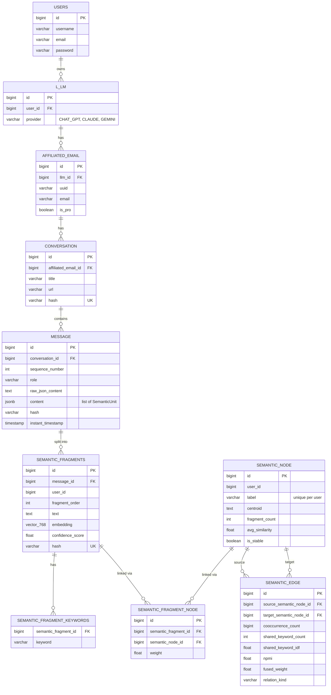

# NeuroIndexEntityService

Shared library of JPA entities, enums, and constants for the NeuroIndex services. It is not a runnable service; [NeuroIndexParserService](https://github.com/Ayush-Thakur-geek/NeuroIndexParserService) depends on it.

## Database diagram

**Reading the diagram**

- Ownership chain: `users → l_lm → affiliated_email → conversation → message → semantic_fragments`.
- `semantic_fragment_node` is the join table that makes fragments and nodes many-to-many. `weight` is the node's relevance within the fragment, and (`semantic_fragment_id`, `semantic_node_id`) is unique.
- `semantic_edge` links two `semantic_node` rows and carries the edge weights used for graph traversal.
- All tables also have `created_date` and `last_modified_date` (from `BaseModel`). Some columns are omitted here for readability; see [`schema.dbml`](schema.dbml) for the complete schema.

To get an interactive version, paste [`schema.dbml`](schema.dbml) into [dbdiagram.io](https://dbdiagram.io).